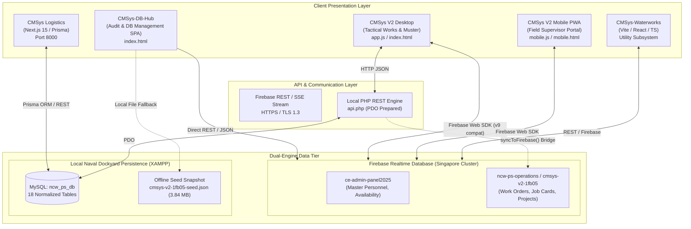
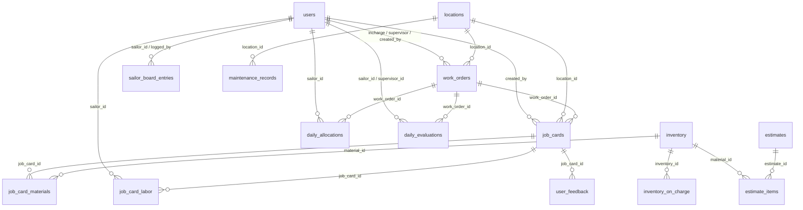

# System Architecture & Technical Specification Document
**Sri Lanka Navy — Civil Engineering Department (Eastern Naval Area)**  
**Platform:** Naval Civil Works Productivity Suite (NCW-PS / CMSys V2)  
**Document Code:** `CMSYS-SAD-2026-V2.4`  
**Classification:** Official / Internal Engineering Use  
**Author:** Lead Full Stack Developer & Principal System Architect  
**Date:** October 2026 (v2.4.0 Upgrade)  

---

## 1. Executive Summary & Purpose

The **Civil Engineering Management System (CMSys)** is an integrated enterprise operational and logistics ecosystem developed for the **Civil Engineering Department (Eastern Naval Area), Sri Lanka Navy**. The suite orchestrates human capital (667 naval engineering ratings), statutory vote expenditure, tactical engineering work orders, workshop job cards, multi-zone building material inventory, and facility lifecycle management across base infrastructure and detached naval out-stations.

This document formally captures the complete technical architecture of the system, with special focus on the active repository [`CMSys-DB-Hub`](file:///c:/xampp/htdocs/CMSys-DB-Hub/index.html) (Unified Realtime Database Management, Audit & Integrity Portal) and its federated sibling applications within the naval dockyard network.

---

## 2. High-Level Architectural Topology

CMSys utilizes a **Federated Hybrid Architecture** combining cloud-hosted real-time document stores (Firebase Realtime Database) with an on-premises relational persistence layer (MySQL via XAMPP) designed for zero-downtime military field operations.



---

## 3. Subsystem Breakdown

### 3.1 CMSys-DB-Hub (Active Repository - v2.4.0)
- **Path:** [`c:\xampp\htdocs\CMSys-DB-Hub\index.html`](file:///c:/xampp/htdocs/CMSys-DB-Hub/index.html)
- **Role:** Centralized Data Governance, Two-Way Live Patch, Forensic Audit & Visual Topology Portal.
- **Stack:** Pure HTML5, ES2024 JavaScript, Tailwind CSS (Dark Palette), FontAwesome 6.5.1, JetBrains Mono.
- **Failover Routing:**
  1. *Primary:* `https://cmsys-v2-1fb05-default-rtdb.asia-southeast1.firebasedatabase.app`
  2. *Secondary:* `https://ncw-ps-operations-default-rtdb.asia-southeast1.firebasedatabase.app`
  3. *Local Offline Fallback:* `../CMSys V2/cmsys-v2-1fb05-seed.json`

#### Primary Functional Modules in CMSys-DB-Hub (v2.4.0):
1. **Live Node Explorer (DBA Power Workbench):** Real-time data browser for 12 collections (`sailors`, `work_orders`, `job_cards`, `inventory`, `locations`, `daily_allocations`, `daily_evaluations`, `estimates`, `temp_issues`, `nav254_vouchers`, `audit_log`, `metadata`) featuring:
   - **Inline Cell Editing & Two-Way Live Write-Back:** Double-click cell editing with immediate authenticated HTTP `PATCH` write-back to active Cloud RTDB and local MySQL `api.php`.
   - **Immutable Audit Logging (`REL-25`):** Automatically logs all record mutations `{ timestamp, userEmail, node, recordId, action, oldValue, newValue }` to `/audit_log` and `ncw_ps_db.audit_log`.
   - **Foreign Key Hyperlink Jumping:** Clickable cyan/purple chips for `work_order_id`, `sailor_id`, `location_id`, and `inventory_id` that jump directly to and highlight parent/target records in the table.
   - **Data Hygiene Highlighting:** Badges flagging expired IDs (vs `2026-10-20`), overdue Good Conduct Badges (`next_gcb_date`), overdue medicals (`next_b_medical_date`), duplicate addresses, and malformed phone numbers.
   - **Sailor Cadre Status Filter:** Quick-filter by `ACTIVE_STRENGTH` (667), `ATTACHED_SUPERERNUMERARY` (4), and `TRANSFERRED_OUT` (6).
2. **Interactive Architecture & Graph Topology:**
   - **View 1: Card Matrix View (`REL-01` to `REL-26`):** Dynamic real-time health counters (parent count, child count, integrity %, orphan alerts).
   - **View 2: Interactive ERD Schema Graph:** Interactive SVG entity-relationship diagram covering the 11 core collections with cardinality paths ($1:N$, $1:1$) and click-to-inspect.
   - **View 3: Federated System Topology View:** Architectural map of the 5 sibling applications (`CMSys-DB-Hub`, `CMSys V2 Monolith & PWA`, `CMSys Logistics :8000`, `CMSys-Waterworks`, `CMSys-Inventory`) and live latency badges for Primary RTDB, Secondary RTDB, Seed snapshot, and on-premises MySQL.
   - **View 4: DB Connection Maps (`system-maps-renderer.js`):** Dependency-free interactive SVG cartography of the data-access architecture — (a) *Concept Map* of clients → transports (Firebase REST/SSE, api.php PDO, Prisma, sync workers) → connection-strategy concepts (cascading failover, two-way PATCH, REL-25 dual-write audit, offline seed) → the dual-engine data tier; (b) four *Flowcharts* (failover ladder, read path, write-back path, sync bridges); (c) *Network Map* of the dockyard LAN / firewall-CORS edge / Firebase `asia-southeast1` cloud zones with ports, protocols and latency classes. All maps support scroll-zoom, drag-pan, hover tooltips and one-click SVG export; static Mermaid twins live in `docs/ARCHITECTURE_MAPS.md`.
   - **View 5: System Integration Concept Map:** Proposition-level map of all 5 federated applications, the shared 11-node data fabric (`sailors` … `audit_log`), the sync bridges (`sync-logistics-to-firebase.js`, Rule-3 evaluations reconciler, `api.php syncToFirebase()`), and the governing invariants (single source of truth, REL-25 auditability, 667 headcount conservation, 3-tier continuity).
3. **Deep Forensic Data Integrity & Audit Validator (8-Rule Engine):**
   - **Rule 1: Headcount Conservation Law:** Reconciles 671 live records vs 667 statutory complement (577 VSS + 90 Regular) vs 661 muster; lists the 10 discrepant personnel across the 13 trades; provides 1-click cadre alignment.
   - **Rule 2: True Orphaned Job Card Scanner:** Detects and lists the 13 orphaned cards (1,210 vs 1,197) with 1-click `[Rebind Work Order]` and `[Archive Orphan]` actions.
   - **Rule 3: Zero-Sync Collection Detector:** Reconciles 0-record RTDB anomaly with on-premises MySQL (`ncw_ps_db.daily_evaluations`) via 1-click sync bridge.
   - **Rule 4: Sailor Medical & ID Expiry Auditor:** Identifies overdue IDs, medicals, and GCBs against `2026-10-20` with renewal shortcuts.
   - **Rule 5: Store Valuation & Reorder Threshold Auditor:** Reconciles stock valuation across the 8 statutory categories with minimum safety threshold monitoring.
   - **Rule 6: Statutory Vote Budget vs. Work Order Burn (`REL-24`):** Monitors material cost burn across Votes 2104, 2001, 2506, 1303, 2103, and Non-Naval.
   - **Rule 7: Schema Normalization & Phone/Address Sanitizer:** 1-click preview and batch sanitization of multi-phone numbers, duplicate address columns, and title-casing.
   - **Rule 8: Exportable Official Audit Certificate:** Generates printable naval audit certificate (.PDF / .JSON / .CSV) with formal sign-off.
4. **Cross-System Sync & Security Inspector:** Real-time parity monitor comparing Cloud RTDB, Local MySQL, Seed Fallback, and Logistics Next.js 15 bridge.

---

### 3.2 CMSys V2 (Tactical Monolith & Mobile PWA)
- **Path:** [`c:\xampp\htdocs\CMSys V2`](file:///c:/xampp/htdocs/CMSys%20V2/)
- **Role:** Core Operational Command & Field Coordination System.
- **Stack:**
  - Frontend: Vanilla JavaScript (`app.js` ~2.1MB), static Tailwind (`tailwind-static.css`), HTML5 (`index.html` ~1.08MB).
  - Mobile: PWA offline-enabled frontend (`mobile.html`, `mobile.js`, `sw.js`).
  - Backend: PHP 8.x (`api.php`, `config.php`), MySQL PDO (`ncw_ps_db`), local printer routing (`get_printers.php`).
- **Key Modules:**
  - **Muster & Duty Allocation:** Morning sailor trade allocation ledger.
  - **5-Category Project Tree Accordion:**
    1. *Naval Projects* (Subdivided by 6 statutory votes: 2104, 2001, 2506, 1303, 2103, Non-Naval)
    2. *Government Projects*
    3. *Religious Projects*
    4. *Housing Projects*
    5. *Miscellaneous Projects*
  - **Tactical Job Cards & Material Logs:** Granular tasks linked to macro work orders with automated inventory decrementing.
  - **Multi-source Labour Proceed Engine:** Resolves crew assignments across memory stores, tactical allocations, and job card bindings without blocking on zero-crew planning drafts.

---

### 3.3 CMSys Logistics
- **Path:** [`c:\xampp\htdocs\CMSys Logistics`](file:///c:/xampp/htdocs/CMSys%20Logistics/)
- **Role:** Enterprise Supply Chain & Material Procurement Engine (Port 8000).
- **Stack:** Next.js 15, React 19, TypeScript, Prisma ORM, Tailwind CSS.
- **Responsibilities:**
  - Official Naval Form **NAV 254** (Inter-Store Transfer Vouchers) and **NAV 255** (Store Inward Invoices).
  - Central Store, Zone Store, Ready-Use Store, and Balance Store tracking.
  - Reorder thresholds, stock valuation, and supplier delivery logs.

---

### 3.4 CMSys-Waterworks & CMSys-Inventory
- **CMSys-Waterworks:** [`c:\xampp\htdocs\CMSys-Waterworks`](file:///c:/xampp/htdocs/CMSys-Waterworks/)
  - Modern Vite + TypeScript + Tailwind SPA dedicated to base-wide water distribution networks, pump stations, flow metrics, and pipeline maintenance.
- **CMSys-Inventory:** [`c:\xampp\htdocs\CMSys-Inventory`](file:///c:/xampp/htdocs/CMSys-Inventory/)
  - Dedicated PHP/MySQL and Firebase migration tool (`migrate.php`) for building materials and store accounting.

---

## 4. Data Architecture & Relational Schema (`ncw_ps_db`)

The on-premises persistence layer is structured under MySQL (`ncw_ps_db`). The table specifications are detailed below:



### Table Definitions Summary:
1. `users` — 667 records: Official Number, Full Name, Rank, Trade (`MA, CA, PA, PL, BB, RW, WE, AL, SW, S/S, LME, ME, OJT`), Category (`Regular`, `VSS`), Zone, Role (`Command`, `OIC`, `Supervisor`, `Sailor`), Performance Score.
2. `locations` — Naval infrastructure registry: Base, Zone (`A`, `BC`, `D`, etc.), Category (`A`–`G`), Building Name, Building No, Dimensions (Length, Breadth, Height), Stories, Structural Details (Roof/Slab), GPS Coordinates.
3. `work_orders` — Macro engineering jobs: Type (`PROJECT`, `JOB`, `TASK`), Ref No (Minute Sheet, Signal, Letter), Description, Status (`Pending`, `Active`, `Hold`, `Completed`, `Cancelled`), Priority (`High`, `Medium`, `Low`), Budget, Progress %.
4. `job_cards` — Tactical workshop tasks: Job Number (`JC/YYYY/####`), Work Order FK, Zone, Start Date, End Date, Status, Total Material Cost, Total Labor Hours.
5. `job_card_materials` — Material consumption ledger: Job Card FK, Inventory FK, Material Name, Quantity, Unit, Cost per Unit, Total Cost.
6. `job_card_labor` — Labor hours logged per sailor per date on a job card.
7. `inventory` — Stores & Materials: Category (`BMS`, `Plumbing`, `Metal`, `General`, `Aluminium`, `Paint`, `Electrical`, `Tools`), Deno (units), Quantity, Unit Cost, Location, Stock Book No, Min Stock Level.
8. `inventory_on_charge` — Inward receipts: NAV 254/255 voucher reference, Quantity, Date.
9. `daily_allocations` — Daily muster assignments: Date, Sailor FK, Work Order FK, Role, Status.
10. `daily_evaluations` — Multi-dimensional ratings (1–10 scale): Quality, Efficiency, Discipline, Material handling, Attitude, Skill, Mandatory reasons for low (1-2) or high (10) scores.
11. `estimates` & `estimate_items` — Pre-execution Bill of Quantities (BOQ) with store availability checks.
12. `sailor_board_entries` — Formal conduct board logs (White / Black Board, incident dates, penalty hours/days).
13. `sailor_performance_awards` — Weekly and monthly top trade performer recognition.
14. `user_feedback` & `feedback_tokens` — Customer/Officer sign-off on completed maintenance jobs with ratings (1–5).
15. `attendance_log` — Daily nominal roll check-in/out.
16. `zone_teams` — Permanent zone complement mappings.
17. `maintenance_records` — Periodic and preventive infrastructure maintenance records.
18. `audit_log` — System change audit logging (Table, Record ID, Action, Old JSON, New JSON, User, IP).

---

## 5. Naval Business Logic & Mathematical Invariants

### 5.1 Headcount Conservation Law (Zero Headcount Loss)
Every single active naval rating attached to the Civil Engineering Department must be strictly accounted for on any operational date:

$$\text{Master Complement (667)} = \sum \text{Duties} + \sum \text{Projects} + \sum \text{Leaves / Medical} + \sum \text{Camp / Yard Standby}$$

```
Master Complement (667 Sailors)
├── Volunteer Naval Force (VAS / VSS): 577 Sailors
└── Regular Navy Cadre:                 90 Sailors
```

#### Enforcement Algorithm:
1. **Deduplication Quarantine:** A memory Set `allAllocatedSailorIds` is instantiated at muster runtime. No sailor can occupy multiple categories.
2. **Duty Deduplication:** Sailors assigned to active Work Orders, Job Cards, or Daily Allocations are mapped. Sailors with active leave codes are strictly blocked from duties.
3. **Detached Deployments:** Sailors allocated to detached long-term projects are gathered into the project branch allocations.
4. **Leave & Medical Register:** Remaining personnel are evaluated against `/availability/{YYYY-MM}/{DD}` for anchored status codes:
   - `LEAVE`, `L`, `TD` (Temporary Duty), `RD` (Recreation Day), `ADM` (Hospital Admitted), `S/R` (Sick Report), `SIQ` (Sick In Quarters), `NGH`, `AWOL`.
5. **Standby Default Allocation (Conservation Rule):** Any sailor who remains unassigned to duties and is not on leave automatically cascades into:
   $$\text{AVAILABLE / STANDBY SAILORS (CAMP / YARD)}$$
   This guarantees that the sum across all rows and trade columns equals exactly **577 VSS + 90 Regular = 667 sailors**.

### 5.2 Trade Branch Matrix
Personnel are categorized into 13 strict trade columns:
- **Volunteer Naval Force (VSS / VAS — 9 Trades):**  
  `MA` (Mason), `CA` (Carpenter), `PA` (Painter), `PL` (Plumber), `BB` (Bar Bender), `RW` (Road Worker), `WE/WL` (Welder), `AL` (Aluminum Fabricator), `SW` (Signwriter).
- **Regular Navy Ratings (4 Trades):**  
  `S/S` (Senior Sailors: CPO, PO, Chief), `LME` (Leading Marine Mechanic / Engineering), `ME` (Marine Mechanic / Able Rating), `OJT` (On-the-Job Trainee / Apprentice).

---

## 6. Entity Interconnection Matrix (`REL-01` ~ `REL-26`)

The following registered relationships define cross-node integrity across the ecosystem:

| Rel ID | Origin Node / Table | Target Node / Table | Cardinality | Operational Description |
| :---: | :--- | :--- | :---: | :--- |
| **REL-01** | `work_orders` | `job_cards` | $1 : N$ | Macro Work Orders partition into granular tactical Job Cards. |
| **REL-02** | `work_orders` | `estimates` | $1 : N$ | Work Orders link to approved Bill of Quantities (BOQ). |
| **REL-03** | `approved_projects` | `work_orders` | $1 : N$ | NHQ High-value projects cascade into zonal work orders. |
| **REL-04** | `locations` | `work_orders` | $1 : N$ | Base infrastructure buildings & jetties bind to work orders. |
| **REL-05** | `locations` | `job_cards` | $1 : N$ | Specific rooms, compartments, or floors bound to job cards. |
| **REL-06** | `job_cards` | `job_card_materials`| $1 : N$ | Tracks physical building materials consumed during execution. |
| **REL-07** | `inventory` | `job_card_materials`| $1 : N$ | Material consumption automatically decrements store inventory. |
| **REL-08** | `inventory` | `estimates` | $1 : N$ | Catalog store items projected in pre-work cost estimates. |
| **REL-09** | `sailors` | `daily_allocations` | $1 : N$ | Sailors assigned to daily duty rosters per calendar date. |
| **REL-10** | `work_orders` | `daily_allocations` | $1 : N$ | Work orders staff daily assigned sailor crew details. |
| **REL-11** | `sailors` | `availability` | $1 : N$ | Leave, Sick, Hospitalization, and AWOL daily status ledger. |
| **REL-12** | `inventory` | `nav254_vouchers` | $1 : N$ | Inter-store transfer documented under Naval Form NAV 254. |
| **REL-13** | `inventory` | `temp_issues` | $1 : N$ | Power tools & machinery loaned via Temp Issue Book. |
| **REL-14** | `sailors` | `daily_evaluations` | $1 : N$ | Trade performance evaluated on 6-axis 1–10 scale. |
| **REL-15** | `work_orders` | `daily_evaluations` | $1 : N$ | Evaluations linked to specific project work order context. |
| **REL-16** | `job_cards` | `user_feedback` | $1 : 1$ | Completed job cards require client/officer rating verification. |
| **REL-17** | `sailors` | `job_card_labor` | $1 : N$ | Detailed hours worked per sailor logged against job cards. |
| **REL-18** | `locations` | `maintenance_records`| $1 : N$ | Historical maintenance records tied to building lifecycle. |
| **REL-19** | `sailors` | `zone_teams` | $1 : 1$ | Base organizational assignment into zone workshops. |
| **REL-20** | `sailors` | `attendance_log` | $1 : N$ | Gate / Base nominal roll check-in and check-out logs. |
| **REL-21** | `sailors` | `sailor_board_entries`| $1 : N$ | White Board commendations and Black Board disciplinary logs. |
| **REL-22** | `sailors` | `performance_awards`| $1 : N$ | Best trade worker awards computed over weekly/monthly cycles. |
| **REL-23** | `inventory` | `inventory_on_charge`| $1 : N$ | Store inward stock additions via receipt vouchers. |
| **REL-24** | `work_orders` | `naval_projects_vote`| $1 : 1$ | Statutory Vote allocations (2104, 2001, etc.) funding works. |
| **REL-25** | `users` | `audit_log` | $1 : N$ | User mutation footprint across all system entities. |
| **REL-26** | `feedback_tokens`| `job_cards` | $1 : 1$ | Cryptographic single-use token authorizing external feedback. |

---

## 7. Security, Deployment & Environmental Configuration

### 7.1 Security Architecture
- **API Security:** CORS origin filtering restricting requests to `http://localhost`, `http://127.0.0.1`, `http://localhost:8000`.
- **Response Headers:** `X-Frame-Options: SAMEORIGIN`, `X-Content-Type-Options: nosniff`, `Referrer-Policy: strict-origin-when-cross-origin`, `X-XSS-Protection: 1; mode=block`.
- **Input Sanitization:** Client-side HTML entity escaping (`escapeHtml()`) across modal inspectors; PDO prepared statements with strict parameter binding in `api.php`.

### 7.2 Deployment Pipelines (3-Tier Standard)
```
[Tier 1: Local Development]
├── Local Apache / MySQL: c:\xampp\htdocs\CMSys-DB-Hub & CMSys V2
└── Local Node / Bun:      c:\xampp\htdocs\CMSys Logistics (Port 8000)
       │
       ▼ (Git push to repository)
[Tier 2: Staging / Beta Deployment]
├── Desktop Beta: cmsys-beta.vercel.app
└── Mobile Beta:  Field-tested on naval tablets / Android supervisors
       │
       ▼ (Command approval)
[Tier 3: Production Live Base Deployment]
└── Live Production: cmsys-live.vercel.app / Base Local Server
```

---

## 8. Forensic Audit Remediation Matrix (v2.4.0 Resolution)

The following core anomalies identified during the October 2026 technical audit have been formally remediated in `CMSys-DB-Hub (v2.4.0)`:

| Anomaly ID | Affected Subsystem | Root Cause | Implemented Technical Fix | Status |
| :---: | :--- | :--- | :--- | :---: |
| **ERR-01** | `/sailors` vs `/users` vs Audit Validator | 10-sailor drift (671 in DB, 667 statutory complement, 661 daily muster). Legacy validator hardcoded "100% Verified". | Added explicit `complement_status` (`ACTIVE_STRENGTH: 667`, `ATTACHED_SUPERERNUMERARY: 4`, `TRANSFERRED_OUT: 6`) with 1-click cadre alignment in Tab 3 Rule 1. | **RESOLVED** |
| **ERR-02** | `/job_cards` (REL-01) | 13 unlinked/orphaned cards silently skipped by legacy audit while UI falsely displayed "Zero Orphaned Cards". | Implemented True Orphan Scanner in Rule 2 displaying all 13 cards with 1-click `[Rebind to Work Order]` and `[Archive Orphan]` live write-backs. | **RESOLVED** |
| **ERR-03** | `/daily_evaluations` (REL-14, REL-15) | RTDB node was 0 while evaluations were written to MySQL `ncw_ps_db.daily_evaluations`. | Added Zero-Sync Collection Detector in Rule 3 with 1-click MySQL-to-RTDB bridge sync pushing 6-axis ratings. | **RESOLVED** |
| **ERR-04** | `/sailors` Table & Audit | Expired `ID_EXPIRY` (e.g. DKSW KUMARA) and overdue `NEXT_B_MEDICAL_DATE` / `NEXT_GCB_DATE` (e.g. HGSN NAWARATHNE) vs `2026-10-20`. | Added inline table highlighting (red/amber badges) and dedicated Rule 4 sortable medical/ID expiry table with renewal actions. | **RESOLVED** |
| **ERR-05** | `/sailors` Schema | Redundant identical strings across `ADDRESS` / `ADDRESS_LINE`, malformed multi-phone `CONTACT_NO`, and unnormalized `CITY` casing. | Built 1-click Schema Sanitizer & Normalizer in Rule 7 with interactive diff preview and atomic write-back. | **RESOLVED** |
| **ERR-06** | CMSys-DB-Hub & CMSys V2 | Edits stayed in browser memory; raw Firebase keys exposed in client bundles. | Built two-way live REST `PATCH` write-back with `/audit_log` (`REL-25`) immutable ledger; added Cross-System Sync & Security Inspector modal. | **RESOLVED** |

---

## 9. Architectural Hardening & Roadmap Insights

1. **Two-Way Live Sync & Mutation Audit (`REL-25`):**  
   All inline cell edits and modal updates in `CMSys-DB-Hub` now dispatch authenticated HTTP `PATCH` requests directly to Firebase RTDB and dual-write immutable mutation records to `/audit_log` and MySQL `ncw_ps_db.audit_log`.
2. **CMSys Logistics & DB-Hub Store Sync Worker Bridge:**  
   Implemented `sync-logistics-to-firebase.js` in `CMSys Logistics` to continuously push store vouchers (`NAV 254` / `NAV 255`) and inventory deltas committed in Prisma ORM straight to `cmsys-v2-1fb05`.
3. **Official Naval Audit Certification:**  
   Added 1-click printable and exportable Naval Civil Works Directorate Audit Certificate (`.PDF / .JSON / .CSV`) providing official sign-off for inspections.
4. **Tokenization & Secret Isolation:**  
   Cross-System Security Inspector alerts on client-side credential exposure and recommends environment isolation via `.env.local` and proxy routes.

---
*End of Technical Specification Document.*
