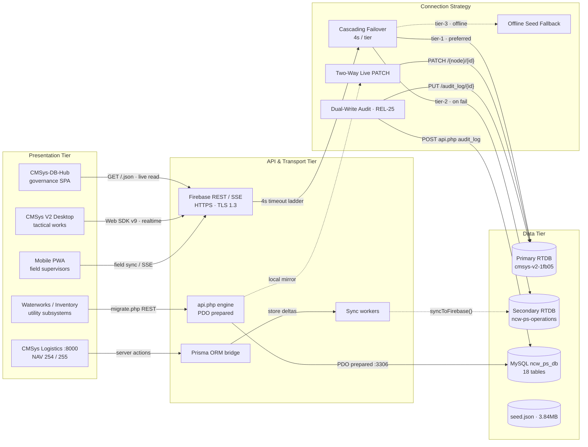
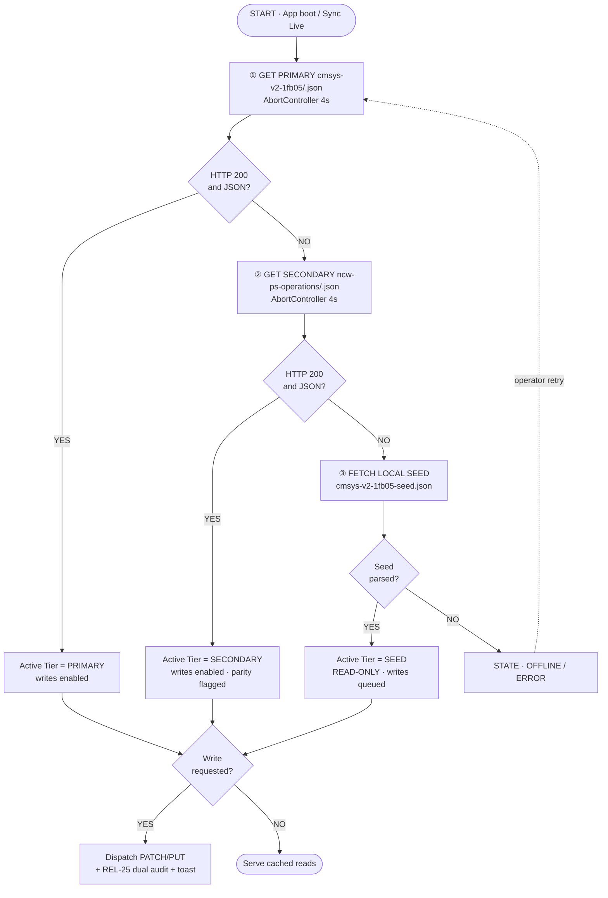
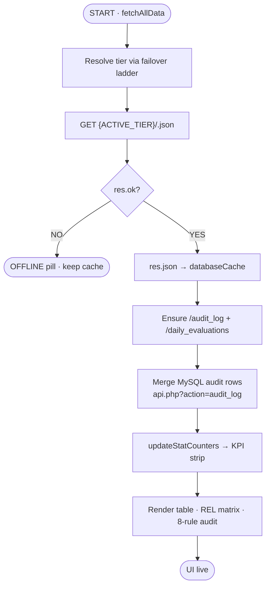
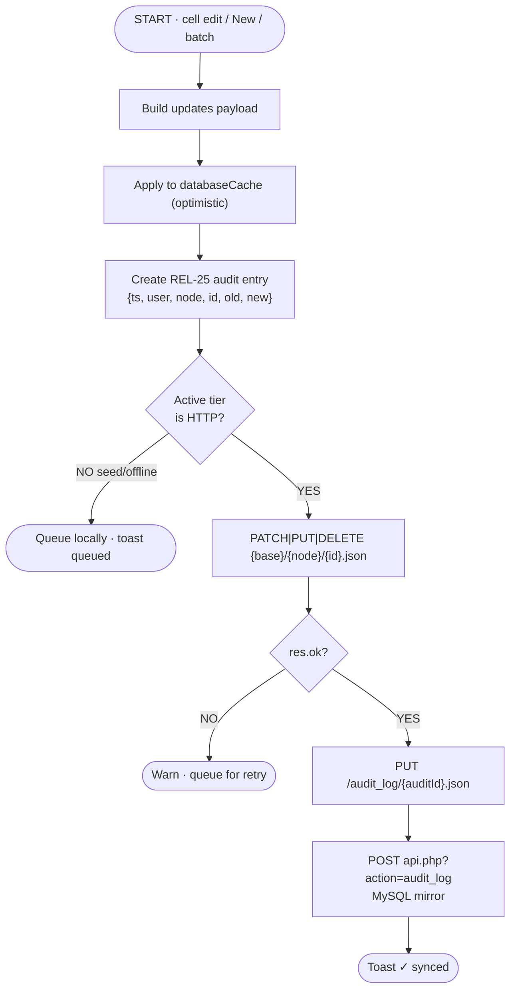
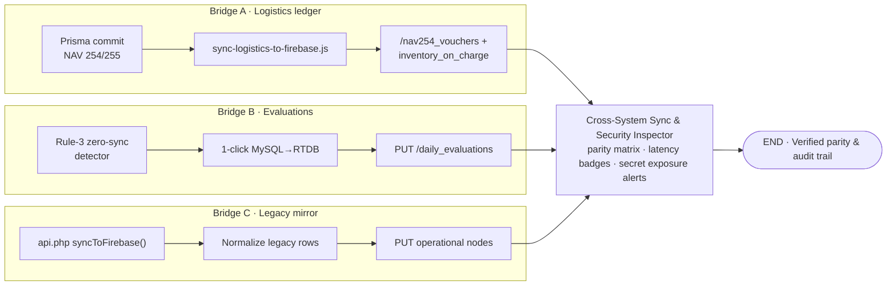
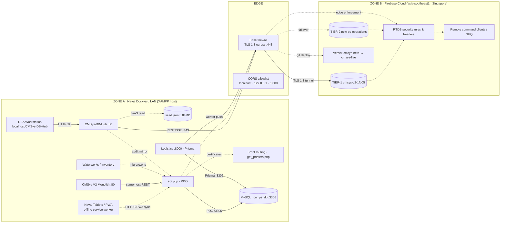
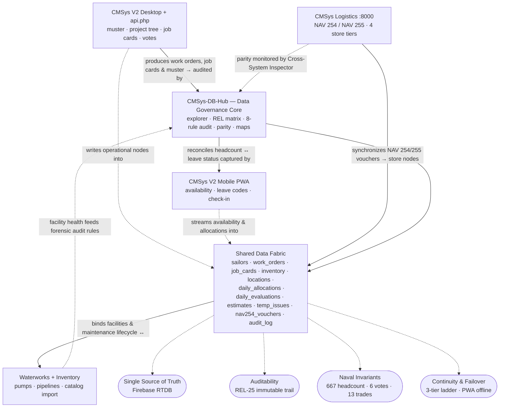

# CMSys-DB-Hub — Architecture Maps
**Companion documentation for the interactive System Maps inside `index.html` → "Architecture & Maps"**

| Map | In-app location | Purpose |
|-----|-----------------|---------|
| **DB Connection Concept Map** | Tab 2 → DB Connection Maps → *Concept Map* | The entities and propositions behind every database connection |
| **Connection Flowcharts (×4)** | Tab 2 → DB Connection Maps → *Flowcharts* | Failover ladder, read path, write-back path, sync bridges |
| **Network Map** | Tab 2 → DB Connection Maps → *Network Map* | Physical/logical topology: LAN → firewall → Firebase cloud |
| **System Integration Concept Map** | Tab 2 → *Integration Map* | All 5 federated applications + shared data fabric + invariants |

> All in-app maps support **scroll-zoom, drag-pan, hover tooltips and one-click SVG export** (toolbar buttons).

---

## 1. Database Connection — Concept Map

Concept maps state *propositions* (labeled edges), not just wires. Four conceptual clusters:

**Connection invariants** (bottom band of the in-app map):
1. **Zero-trust failover** — every client resolves data through the ladder; no silent single-tier dependency.
2. **Single source of truth** — `cmsys-v2-1fb05` is authoritative; mirrors reconcile, never mix in one query.
3. **Immutable mutation trail (REL-25)** — every write emits an audit entity, dual-written cloud + SQL.
4. **Field continuity** — seed fallback + PWA service worker survive total link loss.

---

## 2. Connection Flowcharts

### 2.1 Cascading Failover (Boot / "Sync Live")

### 2.2 Read Path (`fetchAllData`)

### 2.3 Write Path (Two-Way Live Write-Back)

### 2.4 Cross-System Sync Bridges

---

## 3. Network Map

**Latency classes:** loopback `< 1 ms` on LAN · `≈ 150–220 ms` RTT to the Singapore cluster (live-pingable in-app via *Ping All Tiers*).

---

## 4. System Integration Concept Map

---

## 5. Security Posture Shown on the Maps

| Control | Where enforced | Visible on |
|---------|----------------|------------|
| TLS 1.3 egress on :443 only | Base firewall | Network Map (EDGE zone) |
| CORS origin allowlist (`localhost`, `127.0.0.1`, `:8000`) | api.php / Apache | Network Map (EDGE zone) |
| PDO prepared statements / parameter binding | api.php → MySQL | Concept Map, Network Map |
| Immutable dual-write audit (REL-25) | PATCH pipeline | Concept Map, Write-Path flowchart |
| Response headers (`X-Frame-Options`, `nosniff`, `Referrer-Policy`) | All HTTP responses | Network Map (SEC node) |
| Client-secret exposure monitoring | Cross-System Inspector | Integration Map, Parity modal |

---

*Generated for CMSys-DB-Hub v2.5.0 — Naval Civil Works Productivity Suite (NCW-PS / CMSys V2).*
